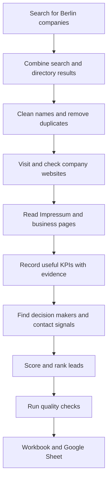

# Heidi Systems: Project Flow

A metering company needs to know which Berlin property managers are worth contacting. The project builds a trustworthy phone book of those companies, adds useful business signals, and ranks the best-fit prospects. It also keeps strategic housing companies and unusable records separate so the final list is practical.

## What happens, in plain language

1. **Find companies:** Search results and Berlin directories are combined, like collecting names from several phone books.
2. **Clean the list:** Names, addresses, and website domains are standardized. Repeated companies are merged.
3. **Check the website:** Each candidate is checked so a directory page is not mistaken for the company's own website.
4. **Read the evidence:** The company's Impressum, contact, service, team, portal, and careers pages are read for useful facts.
5. **Add business signals:** Portfolio size, management type, software, metering signals, energy signals, growth, and contactability are recorded only when supported by the company's pages.
6. **Rank the fit:** A transparent score turns those signals into Tier A, B, C, or Strategic.
7. **Prepare outreach:** Decision makers, personal email signals, and search-result LinkedIn matches are added with clear status labels.
8. **Deliver the result:** Automated checks confirm the rules, then the workbook is exported with source information.

## Who does what

Three AI helpers handle the judgement-heavy work:

- **Discovery classifier:** decides whether a search result looks like a real property manager.
- **Enrichment/KPI extractor:** reads company pages and returns structured facts with evidence.
- **Contact finder:** identifies likely decision makers and contact signals.

Automatic code handles website checks, crawling, text cleanup, duplicate removal, scoring, auditing, and workbook export.

## How we keep the data trustworthy

- Every active company has a reachable company website and a Berlin postcode.
- Directory, redirect, and duplicate domains are removed from the active list.
- KPI values require supporting text from the company's own website.
- Generic role mailboxes are kept separate from personal contact fields.
- Email status distinguishes Hunter verification from MX-only confirmation.
- Source URLs and discovery sources remain attached to the rows and Sources tab.

## What is in the workbook

- **README:** How to use the workbook, definitions, limitations, and compliance notes.
- **Leads:** 266 private Berlin property managers.
- **Strategic:** 25 large housing companies and cooperatives.
- **Directory-only:** 99 companies retained without an active website.
- **Excluded:** 731 filtered records with reasons.
- **Sources:** 7 provenance and reconciliation rows; companies can appear under several sources.
- **Validation:** 40 representative output rows and their data fields.

## Mini glossary

- **Hausverwaltung:** A company that manages residential or commercial property.
- **KPI:** A measurable business indicator, such as units managed.
- **Impressum:** The legally required company information page on a German website.
- **Lead score/tier:** A transparent fit score and its A, B, C, or Strategic category.
- **Domain/MX check:** A domain identifies a website; an MX check confirms that the domain accepts email.
- **LLM/agent:** A language model and a focused software helper that uses it for a defined task.
